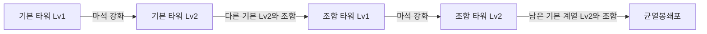

# Gatefall 강화와 조합 중심 확장 기획

2026년 10월 26일 · Android 우선, iOS 공통 조작 · v0.3.0 구현 기준

**헌터로 위급한 전선을 지키면서 타워를 강화하고, 공개된 조합식으로 상위 타워를 완성하는 도시 방어 게임.** 다음 플레이 가능 버전부터 실제 타워를 재료로 소비하는 조합을 넣는다. 한 판은 기존처럼 3분이며, 첫 조합은 약 60–90초, 두 번째 성장 결정은 120초 이후에 경험하도록 설계한다.

사용자가 결정한 요구는 이동·자동 공격·결계 방어, 더 넓고 어려운 전장, 타워 강화, 게임 안에서 조합법을 확인하고 실행하는 기능이다. 아래 이름·비용·효과·수량은 v0.3.0 PC/APK에 구현한 시험값이다. 타워 능력치·가격·조합식·웨이브 편성은 런타임과 106개 항목으로 대조했다. 아래 설계 의도와 후속 플레이테스트 목표를 모든 검증이 완료되었다는 뜻으로 읽지 않는다. 실제 확인 범위는 [검증 기록](C:/Users/Pro/Documents/ChatGPT/react/gatefall-unity/TestResults/runtime-verification.md)을 따른다.

이 문서는 이전의 “연계 효과부터 시험하고 실제 합성은 나중에 추가”하는 안을 대체한다. 최신 숫자 입력은 [조합 밸런스 데이터](C:/Users/Pro/Documents/ChatGPT/react/gatefall-unity/Docs/Design/combination-balance-v2.json)에 있으며, 현재 게임은 이 파일을 읽지 않는다.

**참고 자료를 우리 게임의 설계로 바꾸는 기준**

| 참고한 원리 | Gatefall 적용 | 새로 제작할 부분 |
|---|---|---|
| 화력·저지·지원의 역할 차이 | 단일 사격·감속·범위 피해의 기본 타워 3종 | 공격 로직, 수치, 표적 정책 |
| 건설과 강화가 서로 다른 구매 판단을 만듦 | 기본 강화, 조합, 조합 결과 강화의 세 지출 | 3분 경제와 조합식 |
| 배치 위치에 따라 지원 효과 가치가 달라짐 | 재료를 합쳐 빈 자리가 생기고 한 위치에 화력이 집중됨 | 슬롯·경로·조합 위치 규칙 |
| 적 종류·경로·시간차로 웨이브 구성 | 조합 전 준비, 조합 후 성능 시험, 양쪽 길 압박 | 도시 맵과 6개 구간 편성 |
| 타워 등급과 역할을 외형으로 전달 | 기본 모듈 3종이 조합 후 외형에 함께 드러남 | 모델·아이콘·이펙트·음향·UI |

원본 분석은 설계 원리와 가독성의 참고 자료로 쓴다. 추출 코드·프리팹·텍스처·음원·맵·원본 가격표를 제품에 이식하는 방식으로 만들지 않는다. 이 설계는 원본 게임의 상시 합성 기능을 복원한 것이 아니라 Gatefall에 맞춰 제안한 조합 시스템이다. [참고 분석](C:/dev/rea_project/realm_defense_work/reports/REALM_DEFENSE_GAMEPLAY_ANALYSIS_2026-10-26.md)

**한 판에서 경험하는 성장**

**강화**는 같은 타워 한 개에 투자하며 위치와 역할을 유지한다. **조합**은 지정된 두 타워를 소모하고 새로운 타워 한 개를 만든다. **전투 연계**는 서로의 효과를 활용하는 전술이다. 게임에서는 강화와 조합을 별도 버튼으로 보여주며, 세 개념을 같은 용어로 안내하지 않는다.

콘텐츠는 기본 3종, 조합 3종, 최종 1종으로 총 7종이다. 기본과 조합 타워는 각각 Lv1·Lv2 두 단계, 최종 타워는 한 단계다. 기본 레벨은 3분 안에 읽고 구매할 수 있도록 두 단계로 제한한다. 후속 판 길이 확장은 이 구조의 구매 속도를 확인한 뒤 정한다.

**기본 타워와 강화**

가격은 판 안에서 얻는 마석이며 유료 재화가 아니다. 피해는 적 한 명 기준, 간격은 초, 거리는 Gatefall 좌표 단위다. 범위·연쇄 공격의 표적 제한은 모두 주 대상 포함 고유 개체 수다.

| 기본 타워 | Lv1 | Lv2에서 달라지는 점 | 건설 / 강화 / 누적 |
|---|---|---|---|
| 자동포탑 | 피해10, 간격0.5, 사거리5.2, 단일 | 피해16 | 40 / 30 / **70** |
| 구속탑 | 피해3, 간격0.9, 사거리4.8, 최대3명, 1.2초간35%감속 | 최대4명, 45%감속 | 45 / 40 / **85** |
| 파열포 | 피해32, 간격2.0, 사거리5.0, 반경1.6, 최대5명 | 피해48, 반경1.9, 최대6명 | 65 / 55 / **120** |

자동포탑은 결계에 가까운 적, 구속탑은 충분한 감속이 없는 선두 적, 파열포는 밀집 구역을 우선한다. 파열포는 발사 시 위치를 고정하고 착탄 시 그 범위에 있는 적에게 피해를 준다. 구속탑의 “최대4명”은 한 발을 네 번 중첩하는 뜻이 아니라 서로 다른 적을 고르는 뜻이다.

**게임 안에서 공개되는 1차 조합식**

두 재료는 모두 Lv2여야 하며 서로 다른 인스턴스여야 한다. 재료 순서는 상관없다. 기본 Lv1 또는 같은 계열끼리의 조합식은 이 버전에 없다. 버튼에서 미충족 조건을 구체적으로 표시한다.

| 조합식 | 추가 마석 | 추가 코어 | 결과 | 처음부터 만든 총 마석 |
|---|---:|---:|---|---:|
| 자동포탑 Lv2 + 구속탑 Lv2 | 40 | 1 | **뇌격탑 Lv1** | **195** |
| 자동포탑 Lv2 + 파열포 Lv2 | 45 | 1 | **파쇄포 Lv1** | **235** |
| 구속탑 Lv2 + 파열포 Lv2 | 45 | 1 | **중력포 Lv1** | **250** |

조합 직후 한 칸에서 더 강한 역할을 수행하지만 두 위치를 동시에 지키지는 못한다. 전체 피해가 모든 상황에서 무조건 두 재료보다 높아야 하는 것은 아니다. 강해진 특기와 잃는 방어 범위를 함께 비교하게 한다.

| 조합 타워 | Lv1 특기 | 60마석으로 Lv2 강화 | 선택할 상황과 남는 약점 |
|---|---|---|---|
| 뇌격탑 | 0.75초마다 24→16→10의 3명 연쇄, 사거리5.4, 연결 거리2.5, 1초간25%감속 | 0.65초, 30→20→14, 1.3초간30%감속 | 빠른 적 혼합 대응. 구속탑 Lv2의 강한 감속은 잃음 |
| 파쇄포 | 1.0초마다 주 대상64, 주변32, 반경1.4·최대5명, 사거리5.4 | 0.9초, 주84/주변42, 반경1.6·최대6명 | 큰 적을 먼저 녹이고 주변도 타격. 감속 없음 |
| 중력포 | 1.4초마다 피해28, 반경1.9·최대6명, 사거리5.2, 1.5초간50%감속 | 1.2초, 피해42, 반경2.2·최대8명, 55%감속 | 길목에 몰린 적 저지. 빠른 단일 적 처리에는 다른 수단 필요 |

뇌격은 한 번 맞은 적에게 다시 튕기지 않는다. 파쇄포의 주 대상은 같은 발의 주변 피해를 중복해서 받지 않는다. 중력포의 감속은 물리적인 이동 경로 봉쇄나 적 끌어당김을 의미하지 않는다.

**조합 결과를 강화해서 최종 조합으로 연결**

조합 타워를 Lv2로 만든 뒤, 첫 조합에 쓰지 않은 기본 계열 Lv2를 재료로 추가한다. 세 경로 모두 최종 누적 비용을 **455마석·코어2개**로 맞춘다. 특정 경로가 최종 조합 가격만으로 정답이 되는 것을 피하기 위한 초기 기준이다.

| 최종 조합식 | 추가 마석 | 추가 코어 | 총 마석 계산 |
|---|---:|---:|---|
| 뇌격탑 Lv2 + 파열포 Lv2 | 80 | 1 | 195 + 60 + 120 + 80 = **455** |
| 파쇄포 Lv2 + 구속탑 Lv2 | 75 | 1 | 235 + 60 + 85 + 75 = **455** |
| 중력포 Lv2 + 자동포탑 Lv2 | 75 | 1 | 250 + 60 + 70 + 75 = **455** |

결과는 **균열봉쇄포**다. 사거리6.4, 간격1.0, 주 대상120/주변60, 반경2.0·최대4명, 1.5초간35%감속을 시험한다. 후반 위협을 압축해서 처리하는 타워지만, 넓은 맵 전체를 공격하지 않는다. 3분판에서 최종 조합을 필수 승리 조건으로 만들지 않고, 분산 강화나 두 개의 1차 조합도 비교한다.

최종 조합에 들어가는 코어는 **새로1개 + 재료에 이미 투자된1개**로 총2개다. 이전 코어를 지우거나 두 번 계산하지 않는다. 세 경로는 같은 결과를 만들되 완성 전 운영이 다르다. 추가 최종 타워와 다른 레시피는 첫 일곱 종류의 역할이 검증된 뒤 확장한다.

**조합의 위치·소모·되돌리기 규칙**

| 항목 | 규칙 |
|---|---|
| 기준 위치 | 선택한 재료 타워의 슬롯 중 하나. 빈 슬롯에 결과를 순간 이동시킬 수 없음 |
| 헌터 위치 | 기준 타워로부터2.15 이내에서 조합 가능. 원격 조합서 열람·목표 지정은 가능 |
| 다른 재료의 위치 | 맵 안의 보유 타워 중 선택 가능. 별도 인접 조건 없음 |
| 소비 | 선택한 두 타워와 추가 마석·코어를 한 번에 소비하고 결과 한 개 생성 |
| 빈 자리 | 다른 재료 슬롯이 비워짐. 미리보기에서 해당 위치와 사라지는 사거리 표시 |
| 재가동 | 결과는1초 재가동 후 정상 공격 간격을 한 번 기다려 첫 공격. 조합으로 즉시 연속 발사하지 않음 |
| 재료 수량 | 인스턴스 두 개를 명시적으로 선택. 같은 ID를 두 번 재료로 사용할 수 없음 |
| 취소·실패 | 확정 전 취소, 재료 누락, 부족한 자원 등 검증 실패 시 자원과 타워 변경 없음 |
| 분해 | 원래 두 타워로 나누는 기능은 첫 버전에 없음 |
| 판매 | 실제 누적 지출 마석의75%를 내림해 반환, 투자된 코어는 전부 반환. 재료 타워는 복구하지 않음 |

코어는60초와120초에 각각1개 자동 지급한다. 드롭 확률이나 조합 카드 획득에 의존하지 않는다. 판매로 코어를 회수할 수 있으므로 코어2개는 “한 판에 딱 두 번 누르는 제한”이 아니라 **현재 전장에 유지할 상위 전력의 한도**다. 팔고 다시 만들 때는 마석 손실을 감수한다.

예: 뇌격탑 Lv1의 누적195를 판매하면146마석·코어1개, 균열봉쇄포의 누적455를 판매하면341마석·코어2개를 받는다. 재료를 파는 가격과 결과를 파는 가격을 동시에 지급하지 않는다. 향후 할인 카드가 생기더라도 원가가 아니라 실제 지출을 기록한다.

강화 시 공격 쿨다운은 남은 비율을 유지한다. 조합·판매 전에 발사한 탄은 발사 당시의 피해값으로 한 번 처리하고, 사라진 타워를 다시 참조해 오류를 내거나 새 피해량으로 중복 계산하지 않는다.

**모바일 조합서와 실행 흐름**

1. 화면 오른쪽에 건설/강화 상황 버튼과 조합서 버튼을 둔다. 조합서를 열면 전투와 게임 시간을 멈춘다.
2. 조합식6개 경로를 처음부터 공개한다. 카드에는 결과 이름·역할·필요 재료 레벨·추가 마석·코어·현재 충족 상태를 표시한다.
3. 목표 하나를 고정하면 HUD에 `자동포탑 Lv2 ✓ / 구속탑 Lv1 → Lv2 / 코어 0/1`처럼 다음 행동을 보여준다. 아직 없는 재료를 무료로 만들어주지는 않는다.
4. 실행 가능한 조합을 고르면 재료 인스턴스를 강조한다. 같은 종류가 여러 개면 사용자가 직접 선택하고, 두 후보의 위치·레벨을 구분해서 보여준다.
5. 결과를 남길 위치를 선택한다. 헌터가 멀면 조합 확정 대신 해당 슬롯으로 이동하라는 안내를 보여준다.
6. 미리보기에서 결과 사거리, 사라지는 두 타워, 비는 슬롯, 비용, 재가동 시간을 보여준다. `조합 확정`을 한 번 누르면 처리한다.
7. 메뉴는 닫히고 모든 기존 터치 입력을 해제한 뒤 전투가 재개된다. 확정한 손가락을 건설 버튼 입력으로 재사용하지 않는다.

미충족 이유는 `구속탑 강화 필요`, `마석15 부족`, `융합 코어 부족`, `기준 타워에 접근 필요`처럼 표시한다. 색깔만으로 준비 상태를 구분하지 않는다. 첫 버전은 드래그로 타워를 겹치는 합성보다 선택식 메뉴를 사용한다. 조합서의 목표 추적은 선택 사항이며, 화면을 닫아도 유지한다.

**맵과 적이 조합 선택을 시험하도록 구성**

맵은36×20, 슬롯8개, 서·북·동 게이트3개와 두 주요 접근 경로를 사용한다. 북쪽 유입은 예고 후 한 접근로에 합류한다. 타워는 길옆 고정 슬롯에 세우고 적은 경로를 따라 이동한다. 넓은 맵과 함께 헌터 추적 카메라, 화면 밖 위험 방향, 항상 보이는 결계 체력을 제공한다.

헌터의 동시 교전은2마리로 시작한다. 초과 적은 결계 경로를 계속 따라가고, 결계 파괴체는 헌터 교전을 무시한다. 헌터가 교전 거리3.0을 벗어나면 해제하고, 해제된 적의 재획득은1초 후 허용한다. 기존0.65초 피격 무적은 우선 유지해 즉사 위험을 따로 관찰한다. 구체적인 충돌·회피 처리와 이동 경로는 구현 단계에서 확인한다.

아래 HP는 상위 타워의 화력을 시험하기 위해 기존 적보다 높인 제안값이다. 기존 게임의 난도 검증 결과를 이 수치에 적용하지 않는다.

| 적 | HP / 속도 | 공격 피해 / 간격 | 처치 마석 | 역할 |
|---|---|---|---:|---|
| 일반 침입체 | 60 / 1.15 | 7 / 1.1 | 1 | 방어선의 기본 처리량 시험 |
| 질주 침입체 | 32 / 2.0 | 7 / 1.1 | 1 | 빈 재료 슬롯 쪽으로 시간차 압박 |
| 중장 침입체 | 220 / 0.85 | 13 / 1.1 | 3 | 큰 단일 표적 처리 시험 |
| 결계 파괴체 | 400 / 0.8 | 24 / 1.5 | 5 | 교전을 무시하고 결계 공격 |

중장은 감속 강도의65%, 파괴체는40%만 적용한다. 예를 들어 중력포 Lv2의55%감속은 파괴체에게22%감속이다. 적의 현재 감속은 가장 강한 유효 효과만 사용하며, 여러 타워의 감속률을 합산하지 않는다. 반복 공격은 해당 효과의 지속 시간을 갱신한다.

**3분 웨이브와 조합 시점**

| 시간 | 일반 / 질주 / 중장 / 파괴체 | 기본 적 수 | 성장·전술 의도 |
|---|---|---:|---|
| 0–30초 | 14 / 0 / 0 / 0 | 14 | 5초 준비, 두 재료 계열을 고르거나 한 계열을 강화 |
| 30–60초 | 14 / 8 / 0 / 0 | 22 | 첫 성장 선택, 반대 방향 질주 적에 대응 |
| 60–90초 | 18 / 0 / 3 / 0 | 21 | 첫 코어 지급, 1차 조합을 실전에 사용 |
| 90–120초 | 16 / 10 / 2 / 0 | 28 | 두 길 동시 압박, 조합으로 비운 자리를 보완 |
| 120–150초 | 14 / 6 / 4 / 2 | 26 | 두 번째 코어, 조합 타워 추가 또는 최종 조합 준비 |
| 150–180초 | 18 / 10 / 4 / 4 | 36 | 준비한 성장의 보상 구간. 예정 스폰은170초 전에 종료 |

총147개이며 추가 소환은 첫 버전에 없다. 각 구간은 전멸 여부와 관계없이 시간표대로 시작한다. 구현 시 이 표 아래에 경로·첫 지연·묶음 간격을 가진 SpawnGroup을 편집한다. 진입 방향과 위협은3초 전에 예고하고 적을 한 프레임에 몰아 생성하지 않는다. 승리는 기존처럼180초에 헌터·결계가 살아 있는 조건이며, 메뉴 일시정지는 게임 시간을 멈춘다.

**조합이 실제로 구매 가능한 자원 흐름**

시작140마석,30/60/90/120/150초에40씩 보급, 코어는60/120초에1개씩이다. 처치 보상은 위 적 표를 따른다. 공급량은 이전 초안의100·20에서 조합 비용을 감당하도록 바꿨다.

| 시점 | 누적 시작·보급 | 그 전 구간의 처치 보상 전부 획득 가정 | 누적 지출 전 예산 상한 | 코어 누적 공급 |
|---|---:|---:|---:|---:|
| 시작 | 140 | 0 | **140** | 0 |
| 30초 | 180 | 14 | **194** | 0 |
| 60초 | 220 | 36 | **256** | 1 |
| 90초 | 260 | 63 | **323** | 1 |
| 120초 | 300 | 95 | **395** | 2 |
| 150초 | 340 | 137 | **477** | 2 |
| 180초 | 340 | 197 | **537** | 2 |

이 표는 스폰 직후 처치 여부까지 증명한 전투 시뮬레이션이 아니다. 이전 구간의 예정 적을 경계 시점까지 모두 처치했다는 가정의 수입 상한이다. 실제 구매는 이동·타격·생존·처치 지연 때문에 늦어질 수 있다. 카드로 얻는 추가 마석도 제외했다.

60초의 첫 조합 예시: 자동포탑·구속탑을 건설하고 Lv2로 올리는 데155, 조합에40을 사용하면195마석·코어1개가 필요하다. 시작+보급만220이므로 처치 수입 없이도 비용상 가능하다. 두 타워로 그때까지 버틸 수 있는지는 플레이테스트 대상이다. 비싼 중력포250은 같은 시점에 처치 수입30 이상이 필요하다.

| 운영 경로 | 최종 배치 예 | 누적 마석 | 유지에 필요한 코어 | 얻는 것 / 포기하는 것 |
|---|---|---:|---:|---|
| 분산 강화 | 자동Lv2×2 + 구속Lv2×2 + 파열Lv2×1 | **430** | 0 | 다섯 위치 방어 / 특별한 조합 공격 없음 |
| 양쪽 전선 조합 | 뇌격Lv1 + 파쇄Lv1 + 구속Lv1 | **475** | 2 | 두 상위 공격 지점과 보조 / 최종 타워를 위한 코어 없음 |
| 최종 조합 집중 | 균열봉쇄포×1 | **455** | 2 | 한 위치의 높은 처리량 / 외곽 방어 범위 감소 |
| 최종과 후방 보완 | 균열봉쇄포 + 자동Lv1 | **495** | 2 | 누출 대응 수단 하나 추가 / 많은 처치 수입 필요 |

최종 조합455는150초 기준 기본 공급340에 처치 수입115가 더 필요하다. 앞5구간 보상137의 약84%를 확보한 가정이다. 따라서 최종 조합은 성공적인 운영의 선택지로 두며, 매 판 모두가 반드시 완성해야 하는 목표로 두지 않는다. 충분히 강화한 분산 배치와 두 조합 운영도 승리 가능한지 같은 시드에서 비교한다.

**로그라이크 선택은 조합식의 접근성을 막지 않음**

30/90/150초에3장 중1장을 고른다. 조합식과 기본 타워는 무작위 해금 없이 처음부터 보인다. 카드는 운영을 바꾸는 보조 성장으로 사용한다. 첫 카드 후보는 탄도 계열 피해+15%, 제어 계열 감속 지속+0.4초, 폭발 계열 반경+0.25, 전체 사거리+10%, 즉시35마석, 헌터 공격 간격10%감소다. 누적 상한은 지속형 카드별2회로 시작하고, 즉시 마석은 선택 횟수만큼 지급한다.

뇌격은 탄도·제어, 파쇄는 탄도·폭발, 중력은 제어·폭발, 최종은 세 태그를 모두 갖는다. 카드 효과는 결과 타워의 기본값에 해당 태그 조건으로 한 번 계산한다. 재료가 각각 가지고 있던 같은 카드 효과를 두 번 상속하지 않는다. 헌터와 타워의 공격속도·피해·사거리 계산 순서는 한 곳에서 관리한다.

자동포탑 피해 카드 두 번은16×(1+0.15+0.15)=20.8처럼 가산 합산 후 한 번 적용한다. 조합식 비용표는 카드 없이 검증한 기준값이다. 이전 초안의 감속 표적 폭발 피해+25%는 상시 기본 규칙에서 제외해 조합 전력과 중복 상승시키지 않는다. 추후 카드 후보로 비교할 수 있다.

**아트와 에셋 제작 방향**

현대 도시의 임시 방어 장비에 마력을 연결한 형태로 통일한다. 기본 장비는 각진 금속 구조, 마력은 청록, 경고는 주황으로 표현한다. 타워 등급은 색뿐 아니라 포신·고리·지지대 수와 조립 상태로 구분한다. 바닥 사거리 표시와 적 진입 방향은 이펙트보다 우선해 읽혀야 한다.

| 대상 | 제작 방향 |
|---|---|
| 자동포탑 | 낮은 삼각 받침, 수평 회전 포신. Lv2는 이중 포신으로 강화 표시 |
| 구속탑 | 세 기둥 사이의 마력 고리. 공격할 때 선택된 적에게 연결선 표시 |
| 파열포 | 높은 사각 발사관과 충전 실린더. 발사 예고·착탄 원을 구분 |
| 뇌격탑 | 포신과 고리가 결합한 도체 구조, 세 표적을 잇는 짧은 연쇄 효과 |
| 파쇄포 | 보강된 다중 발사관, 주 표적 타격과 주변 파편을 다른 크기로 표시 |
| 중력포 | 지면을 향한 링과 압력 장치, 범위를 읽을 수 있는 낮은 파동 |
| 균열봉쇄포 | 세 모듈이 결합한 봉쇄 장치, 외형에서 최종 조합임을 구분 |
| 조합 연출 | 선택한 두 슬롯에서 에너지가 기준 슬롯으로 이동, 비는 슬롯은 즉시 표시 |

첫 구현은 기존 절차적 도형을 확장해 조작과 성장 규칙을 확인하고, 그 뒤 위 제작 명세에 맞춰 자체 제작 또는 상업 이용 가능한 라이선스의 자산으로 교체한다. 원본의 실루엣·텍스처·아이콘을 수정한 것을 새 에셋으로 취급하지 않는다. 조합 시 이펙트가 결계 체력이나 위험 방향을 가리지 않게 한다.

**구현 데이터와 실패 방지 조건**

현재 [Tower 모델](C:/Users/Pro/Documents/ChatGPT/react/gatefall-unity/Assets/Scripts/Core/DefenseSimulation.cs:58)은 위치·슬롯·쿨다운만 가진다. 다음 구현에는 타워 정의ID, 고유 인스턴스ID, 레벨, 실제 누적 마석 지출, 투자 코어 수, 상태·재가동 시간과 재료 이력을 추가한다. 저장 데이터와 UI는 동일 정의를 참조한다.

| 정의 | 필요한 내용 |
|---|---|
| TowerDefinition | 이름·역할 태그·등급·레벨별 수치·건설/강화비·표적 정책 |
| RecipeDefinition | 재료 종류/정확한 레벨/수량·추가 마석/코어·결과 종류/레벨 |
| FusionCommand | 선택한 두 인스턴스ID·기준 슬롯·레시피ID·중복 실행 방지ID |
| WaveDefinition | 시간 구간·경로·지연·묶음·처치 보상·보급 이벤트 |
| RunState | 보유 마석·미사용 코어·현재 타워·카드·목표 조합·지급 완료 이벤트 |

조합 처리 순서는 **상태·ID·레벨·거리·재화 검증 → 결과 생성 준비 → 한 번에 교체·차감 → UI 갱신**이다. 실패하면 원래 상태를 유지한다. 더블탭, 같은 재료ID 두 번, 판매와 조합의 충돌, 일시정지/복귀로 지급이나 소비가 중복되지 않아야 한다. 이벤트 시각은 일시정지를 제외한 게임 시간으로 관리한다. 첫 버전은 백그라운드에서 일시정지하고, 프로세스가 종료되면 새 판으로 시작한다. 이어하기 저장을 추가할 때는 지급 완료 이벤트와 거래 이력도 함께 복구한다.

결과의 누적 마석은 두 재료의 실제 누적 마석 합계+조합비다. 투자 코어도 두 재료 투자분+추가 코어다. 유효 범위 안에서 `현재 마석+누적 실제 지출-판매환급=시작·보급+처치+카드수입`, `미사용 코어+배치 타워의 투자 코어=지급된 코어`를 검사할 수 있어야 한다. 여기서 지출은 실제로 차감한 거래 합계이며 재료의 과거 투자비를 조합할 때 다시 지출로 더하지 않는다. 타워 공격 버프는 재료의 일시 효과를 복사하지 않고 결과 정의·현재 카드·현재 주변 버프로 다시 계산한다.

**다음 버전의 완료 기준과 순서**

| 순서 | 구현 묶음 | 통과해야 할 내용 |
|---|---|---|
| 1 | 정의 데이터·기본3종·강화·8슬롯 | 가격과 실제 차감 일치, 강화 전후 효과 표시, 기존 이동·자동 공격 유지 |
| 2 | 조합식6경로·결과4종·조합 결과 강화 | 모든 레시피 실행, 두 재료 소비/빈 슬롯, 투자비·코어 보존, 취소·중복 입력 처리 |
| 3 | 조합서·재료 선택·결과 미리보기·목표 추적 | 휴대폰 가로 화면에서 조건을 읽고 의도한 타워를 선택할 수 있음 |
| 4 | 확대 맵·경로·교전 제한·4적·6구간 | 첫 조합을 쓰는 시간과 빈 방어 구역의 위험이 실제 전투에서 드러남 |
| 5 | 카드·판매·경제 로그·복귀 처리 | 카드의 태그 적용이 조합 후 한 번만 계산되고 코어·마석 중복 생성 없음 |
| 6 | PC 미리보기와 Android APK 검증 | 기본/조합/최종 운영 경로 비교, 실제 터치·가독성·프레임 시간 기록 |

첫 완성 빌드에는 강화와 실제 조합이 모두 포함되어야 한다. 단계별 내부 구현은 가능하지만 조합이 빠진 상태를 이 기획의 완료로 보지 않는다. 광고·결제·장비 파밍·추가 영웅·자유 미로·원본 게임 서버 연동은 이 버전의 목표에 포함하지 않는다.

플레이테스트에서는 첫 조합 시각, 조합 재료 구매 순서, 빈 슬롯에서 발생한 누출, 타워별 유효 피해·제어 시간, 결과별 선택 비중·승패, 남은 마석·코어, 모바일 오입력을 기록한다. 첫 조합이 지나치게 늦으면 재료 비용·보급·조건을, 조합 하나만 정답이면 역할·경로·상대 적을 조정한다. 예산 검증 통과와 전투 난도 검증을 구분한다.

참고: [기존 구현 안내](C:/Users/Pro/Documents/ChatGPT/react/gatefall-unity/README.md), [수치·레시피 예산 검증](C:/Users/Pro/Documents/ChatGPT/react/gatefall-unity/Docs/Design/combination-validation-v2.json).
